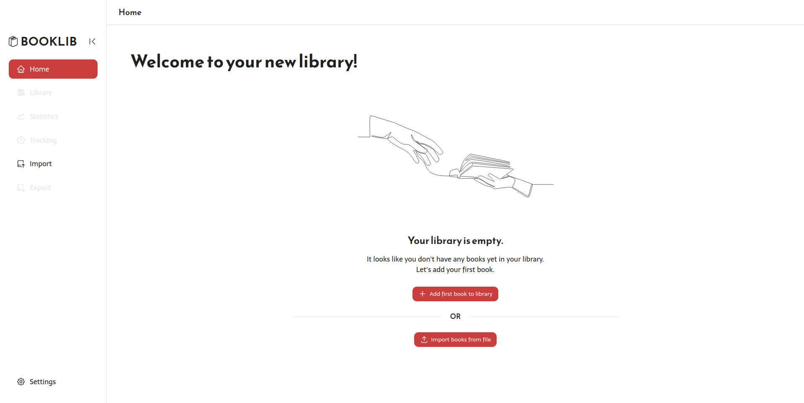
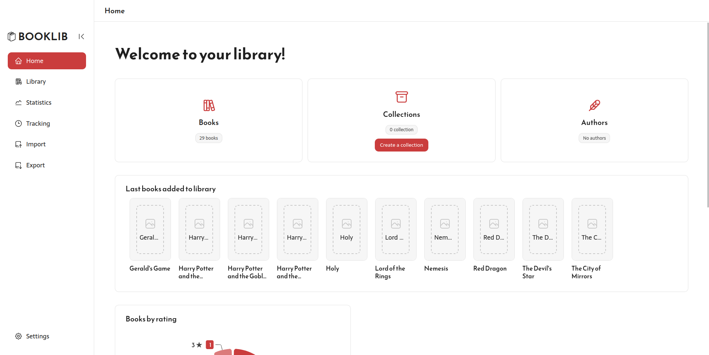
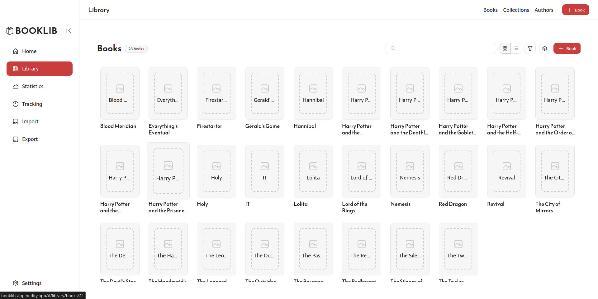
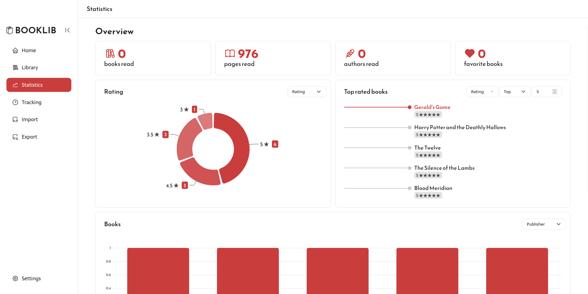
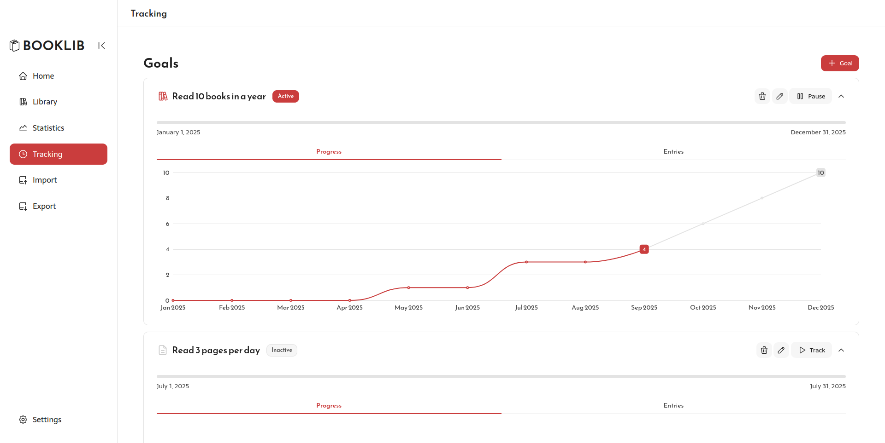
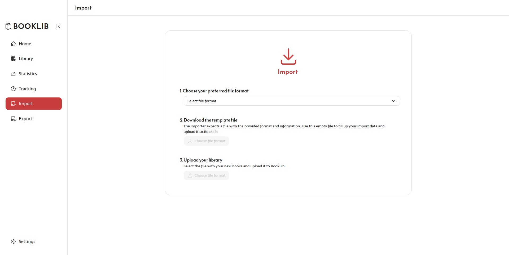

<div align="center">
  
  <h1>BookLib</h1>
  <p>Manage your personal library and reach your reading goals.</p>
  
  [](https://github.com/deadalley/booklib-app)
  [](https://nuxt.com)
  [](https://vuejs.org)
  [](https://www.typescriptlang.org)
  [](https://www.electronjs.org)
  
  [Getting Started](#quick-start) | [Development](#development)
</div>

---

<div align="center">
  <a href="https://booklib-app.netlify.app" target="_blank">
    
  </a>
  <a href="https://github.com/deadalley/booklib-app/releases/latest" target="_blank">
    
  </a>
</div>

The live demo keeps your library in the browser only. To keep it safely on
your device, download the app for Windows, Linux or Android from the
[latest release](https://github.com/deadalley/booklib-app/releases/latest).

<div>
  <div align="center">
    <h3>📖 Book Management</h3>
    <p>Manage your book collection, find your favorite books, organize them in collections, and so much more.</p>
  </div>
  <div align="center">
    <h3>🎯 Goal Tracking</h3>
    <p>Tracking your reading goals by books, pages, or hours and achieve your reading targets.</p>
  </div>
  <div align="center">
    <h3>📦 Importing & Exporting</h3>
    <p>Export and import your library in CSV and JSON formats for easy portability.</p>
  </div>
</div>

---

- [Quick Start](#quick-start)
  - [Installation](#installation)
- [Development](#development)
  - [Available Scripts](#available-scripts)
    - [Development](#development-1)
    - [Building](#building)
    - [Testing](#testing)
    - [Linting](#linting)
    - [Desktop App (Electron)](#desktop-app-electron)
    - [Android App (Capacitor)](#android-app-capacitor)
    - [Releasing](#releasing)
- [Architecture](#architecture)
  - [Tech Stack](#tech-stack)
  - [Project Structure](#project-structure)
  - [Storage Architecture](#storage-architecture)
- [Usage](#usage)
  - [Getting Started](#getting-started)
- [Testing](#testing-1)
- [Tools](#tools)
- [Screenshots](#screenshots)
  - [Start page](#start-page)
  - [Home page](#home-page)
  - [Library page](#library-page)
  - [Stats page](#stats-page)
  - [Tracking page](#tracking-page)
  - [Import page](#import-page)
- [License](#license)

---

## Quick Start

### Installation

1. **Clone the repository**

   ```bash
   git clone https://github.com/deadalley/booklib-app.git
   cd booklib-app
   ```

2. **Install dependencies**

   ```bash
   pnpm install
   ```

3. **Start development server**
   ```bash
   # Web version
   pnpm dev
   ```

The web application will be available at `http://localhost:3000`

## Development

### Available Scripts

#### Development

```bash
pnpm dev              # Start web development server
```

#### Building

```bash
pnpm build:electron  # Build for Electron (desktop app)
pnpm build:web       # Build for web deployment
pnpm preview         # Preview production build
```

#### Testing

```bash
pnpm test            # Run unit tests
pnpm test:e2e        # Run end-to-end tests
pnpm test:e2e:ui     # Run e2e tests with UI
pnpm coverage        # Generate test coverage report
```

#### Linting

```bash
pnpm lint            # Run all linters
pnpm lint:fix        # Fix linting issues
pnpm lint:js         # ESLint JavaScript/TypeScript
pnpm lint:ts         # TypeScript type checking
pnpm lint:prettier   # Prettier formatting check
```

#### Desktop App (Electron)

```bash
pnpm dev:electron             # Run the desktop app in development
pnpm electron:dir             # Build an unpacked app in dist-packaged/ (quick local test)
pnpm electron:build:linux     # Build the AppImage and .deb
pnpm electron:build:win       # Build the Windows installer (.exe) and portable .zip
pnpm electron:build:win:docker # Build for Windows from Linux/macOS using Docker + Wine
```

Each command builds the app first (`pnpm build:electron`), and the installers
are written to `dist-packaged/`. To build for Windows from Linux without
Docker, install Wine first (`wine64` and `wine32`).

On Linux, the app is started through a small launcher
([`scripts/linux-sandbox-wrapper.cjs`](scripts/linux-sandbox-wrapper.cjs)).
Some distributions, such as Ubuntu 24.04, block the user namespaces that
Chromium's sandbox needs, and an AppImage can't use the setuid fallback. On
those systems the launcher starts the AppImage with `--no-sandbox` instead of
letting it crash. The `.deb` keeps the full sandbox, so prefer it on
Debian/Ubuntu.

#### Android App (Capacitor)

The Android app wraps the same Nuxt app in a native WebView with
[Capacitor](https://capacitorjs.com). It needs JDK 21 and the Android SDK
(installed with Android Studio, or set `ANDROID_HOME`).

```bash
pnpm build:android   # Build the web app and copy it into android/
pnpm android:open    # Open the project in Android Studio to run it on a device
pnpm android:build   # Build a debug APK in android/app/build/outputs/apk/debug/
```

#### Releasing

Publishing a [GitHub release](https://github.com/deadalley/booklib-app/releases/new)
with a version tag such as `v1.2.0` runs the
[release workflow](.github/workflows/release.yml). It builds the Windows,
Linux and Android apps, uses the tag as the app version, attaches the install
files to the release and adds a download table to the release notes. To rebuild
the files of an existing release, run the workflow manually with its tag.

## Architecture

### Tech Stack

- **Frontend**: Vue 3 + Nuxt 3 + TypeScript
- **Styling**: Tailwind CSS
- **Charts**: ECharts with vue-echarts
- **Icons**: Tabler Icons
- **Forms**: FormKit
- **Tables**: TanStack Table
- **Testing**: Vitest + Playwright
- **Desktop**: Electron
- **Android**: Capacitor
- **Database**: LowDB (JSON-based)

### Project Structure

```
booklib-app/
├── components/         # Vue components
├── composables/        # Vue composables
├── pages/             # Nuxt pages (routing)
├── layouts/           # Nuxt layouts
├── services/          # Business logic and data management
├── types/             # TypeScript type definitions
├── utils/             # Utility functions
├── assets/            # Static assets and styles
├── public/            # Public static files
├── electron/          # Electron main process files
├── android/           # Android (Capacitor) project
├── tests/             # Test files
└── playwright-report/ # E2E test reports
```

### Storage Architecture

BookLib uses a flexible storage system that adapts to the environment:

- **Electron**: File-based storage in user data directory
- **Android**: File-based storage in the app's private data directory
- **Web**: LocalStorage fallback for browser compatibility

See [STORAGE_ARCHITECTURE.md](STORAGE_ARCHITECTURE.md) for detailed information.

## Usage

### Getting Started

1. **Add your first book** - Use the "+" button to manually add books or search Google Books
2. **Create collections** - Organize books into custom collections
3. **Set reading goals** - Track your reading progress with customizable goals
4. **Import your library** - Bulk import books from CSV or other formats

## Testing

- **Unit tests** with Vitest, colocated as `*.test.ts` (utilities, the data
  service, the import/export module in `services/transfer`, composables and
  components)
- **End-to-end tests** with Playwright in `tests/`. Each test seeds its own
  library into the browser's storage through `tests/fixtures.ts`, so tests are
  isolated and can run in parallel.

Run tests:

```bash
pnpm test             # Unit tests
pnpm test:tz          # Date-sensitive unit tests in other time zones
pnpm test:e2e         # E2E tests (desktop + responsive viewport sweep)
pnpm test:e2e:mobile  # E2E tests on a phone viewport
pnpm test:e2e:all     # Every Playwright project, including Firefox and WebKit
pnpm lint:ts          # Type checking
```

The e2e tests start the app on port 3001. To run them against an app that is
already running, set `BASE_URL` (for example `BASE_URL=http://127.0.0.1:3000`).
To use an existing Chromium instead of Playwright's download, set
`PW_CHROMIUM_PATH` to its executable.

### Import and export format

Imports and exports share one format, defined by the field registry in
`services/transfer/schema.ts`. CSV headers, JSON keys, the templates in
`public/templates` and validation all derive from it. Every book field except
collections can be imported; a full backup (Data Management → Full backup)
also restores collections, authors and goals.

## Tools

- [Nuxt 3](https://nuxt.com/)
- [Vue 3](https://vuejs.org/)
- [Tailwind CSS](https://tailwindcss.com/)
- [ECharts](https://echarts.apache.org/)
- [Electron](https://www.electronjs.org/)

## Screenshots

<details>
<summary>View screenshots</summary>

### Start page



### Home page



### Library page



### Stats page



### Tracking page



### Import page



</details>

## License

This project is licensed under the MIT License. See the [LICENSE](LICENSE) file for details.
